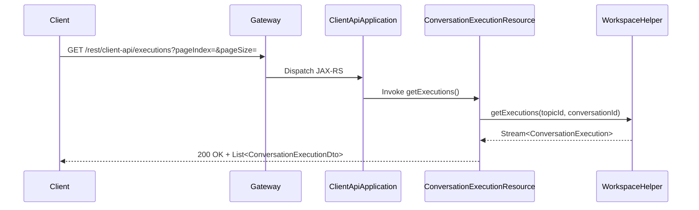
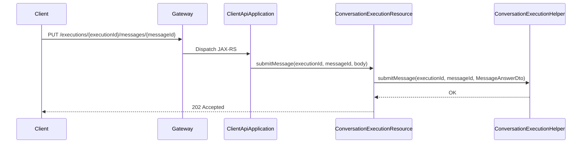

# Client API Extension Architecture

## 1. Overview

The Client API extension exposes a RESTful façade on top of the Krista Workspace and SDK domains. It allows external clients to list and query accounts, topics, conversations, executions, and messages, and to drive conversation executions programmatically.

This document describes the layered architecture, key components, performance characteristics and limits, and error-handling behavior, with diagrams that mirror the actual code structure.

---

## 2. Layered Architecture

### 2.1 Layer Diagram

```mermaid
flowchart LR
    Client[External Client / SDK] -->|HTTP / WebSocket| GW[Krista REST Gateway]
    GW --> APP[ClientApiApplication (JAX-RS)]

    APP --> RES[Resources<br/>Account/Topic/Conversation/Execution/Document]
    APP --> EXCPT[ClientApiExceptionMapper]

    RES --> AUTH[ClientApiRequestAuthenticator]
    RES --> WS[Workspace / Entity APIs]

    WS --> DOM[Accounts / Topics / Conversations / Executions]

    AUTH --> AUTH_EXT[Authentication Extension]
    RES --> EXT_META[ClientApiExtension + extension.json]
```

---

### 2.2 Layers

1. **Gateway & Hosting Layer**  
   - Krista platform HTTP / WebSocket gateway.  
   - Hosts the JAX-RS `ClientApiApplication` and routes `/rest/client-api/...` paths.

2. **API & Integration Layer (JAX-RS)**  
   - `ClientApiApplication` registers:
     - `AccountResource`, `TopicResource`, `ConversationResource`, `ConversationExecutionResource`, `DocumentResource`.  
     - `ClientApiExceptionMapper` for centralized error translation.  
   - OpenAPI description in `src/main/resources/docs/KristaSdkApi.yaml`, served with static UI under `/docs`.

3. **Authentication & Security Layer**  
   - `ClientApiExtension.getRequestAuthenticator()` returns a `ClientApiRequestAuthenticator`.  
   - `ClientApiRequestAuthenticator` wraps a RequestAuthenticator from the **Authentication** extension, reusing the same logic for HTTP and WebSocket connections.  
   - All resources are protected; unauthorized access results in mapped `401` responses.

4. **Client API Service & DTO Layer**  
   - JAX-RS resources implement use cases:
     - Accounts listing and lookup.  
     - Topics and conversations listing and lookup.  
     - Executions lifecycle (create, list, terminate) and messages (list, fetch, submit).  
   - DTOs (`AccountDto`, `TopicDto`, `ConversationInfoDto`, `ConversationExecutionDto`, `MessageDto`, `MessageAnswerDto`) map internal SDK models to stable JSON contracts.  
   - `MessageDtoFactory` converts SDK message hierarchy to `MessageDto` instances.

5. **Workspace & Domain Integration Layer**  
   - `WorkspaceHelper` and `ConversationExecutionHelper` wrap `Workspace` access.  
   - All reads/writes (list accounts, get topics, execute conversations, read messages, submit answers) flow through these helpers, which encapsulate domain logic and ID lookups.

6. **Extension Metadata & Configuration Layer**  
   - `extension.json` declares:
     - Domains: `Authentication`, `SDK`.  
     - Dependencies: binding to an Authentication invoker.  
     - `apiRequests` routing for `rest`, `static`, `authn`.  
     - `invokerRequests` (AUTHENTICATOR, VALIDATE_ATTRIBUTES, CUSTOM_TABS).  
   - `ClientApiExtension` implements invoker/forwarding logic and contributes a docs tab pointing to `rest/docs`.

---

## 3. Request Flow Diagrams

### 3.1 Typical Read Request (GET /executions)



### 3.2 Write Request (Submit Message)



---

## 4. Performance Characteristics and Limits

### 4.1 Pagination

- Constants defined in `ClientApiConstants`:
  - `DEFAULT_PAGE_INDEX = "0"`  
  - `DEFAULT_PAGE_SIZE = "20"`  
  - `MAX_PAGE_SIZE = 50`  
- Endpoints that list entities (accounts, topics, conversations, executions) use:
  - `pageIndex` and `pageSize` query parameters.  
  - `@Max(ClientApiConstants.MAX_PAGE_SIZE)` on `pageSize` to enforce upper bound.  
  - `Pages.streamPage(...)` to page over streams from the workspace.

### 4.2 Message Retrieval

- `GET /executions/{executionId}/messages` uses:
  - `offsetId` (start after a specific message) and `limit` (maximum number of messages).  
- The extension does not impose a hard `limit` upper bound at the constant level; callers should choose reasonable values to avoid large responses.

### 4.3 Scalability Notes

- The extension delegates listing and search to the `Workspace` and SDK utilities (matchers, paging helpers).  
- Performance scales with underlying workspace implementation (data store, indexes).  
- Clients SHOULD:
  - Always supply `pageSize` where large result sets are expected.  
  - Use `offsetId` for incremental message polling instead of requesting all messages.

---

## 5. Error Handling and Scenarios

### 5.1 Central Exception Mapping

- `ClientApiExceptionMapper` maps Java exceptions to HTTP responses:
  - `AuthorizationException` → **401 Unauthorized**, body: `ERR_UNAUTHORIZED` or exception message.  
  - `NoSuchElementException`, `NotFoundException` → **404 Not Found**, body: specific or generic not-found message.  
  - `IllegalArgumentException`, `IllegalStateException` → **400 Bad Request**, body: `ERR_BAD_REQUEST` or exception message.  
  - Any other `Throwable` → **500 Internal Server Error**, body: `ERR_SOMETHING_WENT_WRONG`.

- Message constants in `ClientApiConstants` provide user-facing texts including:
  - `ERR_ARG_*` (e.g., `ERR_ARG_EXECUTION_NOT_FOUND`).  
  - `TOPIC_NOT_FOUND`, `EXECUTION_NOT_FOUND`, `CONVERSATION_NOT_FOUND`, `NOT_FOUND`.

### 5.2 Resource-Level Error Scenarios

- `ConversationExecutionResource` examples:
  - `getExecution(executionId)`:
    - Throws `NotFoundException` with a formatted message if execution ID does not exist.  
  - `terminate(executionId)`:
    - Catches `NoSuchElementException` and rethrows `NotFoundException` using `ERR_ARG_EXECUTION_NOT_FOUND`.  
  - `execute()`:
    - Catches `NoSuchElementException` on invalid `conversationId` and throws `NotFoundException` using `ERR_ARG_CONVERSATION_NOT_FOUND`.  
  - `getMessages(...)`:
    - `NoSuchElementException` → 404.  
    - `MessageDtoFactory.UnknownMessageType` → currently returns `null` (treated as empty body / 204‑like by clients or mappers).  
  - `submitMessage(...)`:
    - Uses `Objects.requireNonNull(messageAnswerDto)` causing `NullPointerException` for missing body → mapped to 500 by the exception mapper.  
    - `NoSuchElementException` for missing execution or message → 404 using `ERR_ARG_EXECUTION_NOT_FOUND`.

### 5.3 Authentication Failures

- Any failure in `ClientApiRequestAuthenticator` or underlying Authentication extension results in:
  - `AuthorizationException` → 401 with `ERR_UNAUTHORIZED`.  
  - Misconfiguration of the Authentication dependency (detected by `VALIDATE_ATTRIBUTES`) prevents the invoker from being used.

---

## 6. Extension Interaction Summary

- **Depends on Authentication Extension** for all request authentication and authorization.  
- **Uses SDK / Workspace** for domain data (accounts, topics, conversations, executions, messages).  
- **Exposes REST API + OpenAPI** for external consumers, and static Swagger UI assets under `/docs`.  
- **No catalog requests are defined**; all functionality is via REST and the SDK workspace APIs.

